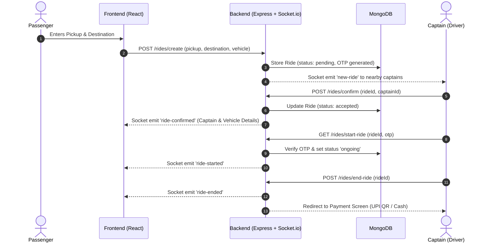

# 🚗 RideMate

<div align="center">


### Real-Time Ride-Hailing & Captain Dispatch Platform
*Next-generation urban mobility connecting passengers and captains seamlessly in real-time.*

[](https://reactjs.org/)
[](https://vitejs.dev/)
[](https://nodejs.org/)
[](https://expressjs.com/)
[](https://www.mongodb.com/)
[](https://socket.io/)
[](https://tailwindcss.com/)

[Explore Features](#-key-features) • [Tech Stack](#-tech-stack) • [Quick Start](#-getting-started) • [API Documentation](#-api-endpoints) • [Socket Events](#-socketio-events)

</div>

---

## 📖 Overview

**RideMate** is an end-to-end, production-ready ride-sharing platform designed with speed, responsiveness, and safety at its core. It brings passengers and captains (drivers) together with instantaneous ride dispatching, interactive live maps, secure OTP trip verification, and automated UPI payment QR codes.

Built with modern full-stack web standards, RideMate features an adaptive dark/light design system, micro-animations, and bidirectional WebSockets for low-latency state synchronization across devices.

---

## ✨ Key Features

### 👤 Passenger Experience
- **Smart Location Autocomplete**: Real-time address suggestions and geocoding via Geoapify API.
- **Dynamic Fare Calculations**: Instant price estimates based on real distance and time across vehicle classes (**Cab Economy**, **Moto**, and **Auto**).
- **Live Ride Tracking**: Interactive map displaying driver location updates and ride progress.
- **Safety OTP**: 4-digit security code generated per ride, required by the captain before any trip can begin.
- **Contactless UPI & Cash**: Auto-generated dynamic UPI QR code with precise trip amounts or traditional cash settlement.

### 🚖 Captain (Driver) Experience
- **Instant Ride Broadcasts**: Instant notification banners with passenger pickup, destination, fare, and distance metrics.
- **Accept / Reject Workflow**: Sliding interactive panels with GSAP animations for frictionless ride management.
- **OTP Validation**: Secure verification interface protecting captains against fraudulent starts.
- **Live Earnings Dashboard**: Real-time tracker for daily earnings, hours online, and total jobs completed.
- **Captain Payment Verification**: Dedicated payment confirmation screen for Cash and UPI transfers.

### 🎨 Design & Engineering Excellence
- **🌓 Flawless Dark Mode**: System-aware theme toggle with persistent state in `localStorage` and custom CSS variable tokens.
- **⚡ Real-Time Socket Architecture**: Dual-room message dispatching ensuring captains only receive rides within their radius.
- **🎬 GSAP Animations**: Smooth bottom-sheet panels, drawer animations, and gesture transitions.

---

## 🛠 Tech Stack

### Frontend
| Technology | Description |
|---|---|
| **React 19** | Modern component-based user interface architecture |
| **Vite 6** | Ultra-fast build tool and lightning-fast Hot Module Replacement |
| **Tailwind CSS + CSS Tokens** | Tailored theme engine supporting persistent Dark & Light modes |
| **GSAP (GreenSock)** | High-performance drawer and panel transitions |
| **Leaflet & OpenStreetMap** | Smooth map rendering and live driver tracking |
| **Socket.io Client** | Real-time event communication with the backend |
| **Remix Icon** | Clean, minimalist icon system |

### Backend
| Technology | Description |
|---|---|
| **Node.js & Express.js** | Modular REST API server architecture |
| **MongoDB & Mongoose** | Schematized data storage with indexing |
| **Socket.io** | Low-latency WebSockets for ride matchmaking & location updates |
| **JWT (JSON Web Tokens)** | Secure authentication and role-based access control |
| **Bcrypt.js** | Cryptographic password hashing |
| **Express Validator** | Strict payload validation and sanitization |
| **Geoapify API** | Reverse geocoding, distance matrix, and autocomplete |

---

## 🏗 Architecture & Flow



---

## 📁 Project Structure

```
Ride_mate/
├── Backend/
│   ├── controller/          # Request handlers (user, captain, ride, maps)
│   ├── db/                  # MongoDB connection setup
│   ├── middleware/          # JWT auth & route protection
│   ├── models/              # Mongoose schemas (User, Captain, Ride, Blacklist)
│   ├── routes/              # Express API route declarations
│   ├── services/            # Business logic, Geoapify API & fare calculators
│   ├── app.js               # Express application initialization & middleware
│   ├── server.js            # HTTP server & WebSocket bootstrap
│   ├── socket.js            # Real-time event handling & socket room mapping
│   ├── .env.example         # Template for environment variables
│   └── package.json
│
├── Frontend/
│   ├── src/
│   │   ├── assets/          # Logos and static media
│   │   ├── components/      # Reusable UI widgets & bottom panels
│   │   │   ├── ConfirmRide.jsx
│   │   │   ├── ConfirmRidePopUp.jsx
│   │   │   ├── DarkModeToggle.jsx
│   │   │   ├── FinishRide.jsx
│   │   │   ├── LiveTracking.jsx
│   │   │   ├── LocationSearchPanel.jsx
│   │   │   ├── LookingForDriver.jsx
│   │   │   ├── RidePopUp.jsx
│   │   │   ├── VehiclePanel.jsx
│   │   │   └── WaitingForDriver.jsx
│   │   ├── context/         # React Contexts (User, Captain, Socket, Theme)
│   │   ├── pages/           # Application views & dashboards
│   │   ├── App.jsx          # Route configuration
│   │   ├── index.css        # Core design tokens & custom properties
│   │   └── main.jsx
│   ├── .env.example         # Frontend configuration template
│   ├── tailwind.config.js
│   ├── vite.config.js
│   └── package.json
│
├── .gitignore
└── README.md
```

---

## 🚀 Getting Started

### Prerequisites
- [Node.js](https://nodejs.org/) (v18.0.0 or higher)
- [MongoDB](https://www.mongodb.com/) (Local instance or MongoDB Atlas cluster)
- [Geoapify API Key](https://www.geoapify.com/) (Free tier available for maps & geocoding)

---

### 1. Clone the Repository
```bash
git clone https://github.com/Uday-Shakya/Ride_mate.git
cd Ride_mate
```

---

### 2. Backend Setup

```bash
# Navigate to the backend directory
cd Backend

# Install dependencies
npm install

# Create environment configuration
cp .env.example .env
```

Configure your `.env` file in the `Backend/` directory:
```env
PORT=3000
DB_CONNECT=mongodb://127.0.0.1:27017/ride-mate
JWT_SECRET=your_jwt_super_secret_key
GEOAPIFY_API_KEY=your_geoapify_api_key
```

Start the backend server:
```bash
# Development mode with auto-reload
npm run dev

# Or production start
npm start
```
*The server will start listening on `http://localhost:3000`.*

---

### 3. Frontend Setup

Open a new terminal window:
```bash
# Navigate to the frontend directory
cd Frontend

# Install dependencies
npm install

# Create frontend environment configuration
cp .env.example .env
```

Configure your `.env` file in the `Frontend/` directory:
```env
VITE_BASE_URL=http://localhost:3000
VITE_GEOAPIFY_API_KEY=your_geoapify_api_key
```

Launch the Vite development server:
```bash
npm run dev
```
*Open [http://localhost:5173](http://localhost:5173) in your browser.*

---

## 📡 API Endpoints

### 🔐 User Routes (`/users`)
| Method | Endpoint | Description | Auth Required |
|---|---|---|---|
| `POST` | `/users/register` | Register a new passenger | No |
| `POST` | `/users/login` | Authenticate user & return JWT | No |
| `GET` | `/users/profile` | Retrieve authenticated user profile | Yes |
| `GET` | `/users/logout` | Invalidate JWT and clear session | Yes |

### 🚖 Captain Routes (`/captains`)
| Method | Endpoint | Description | Auth Required |
|---|---|---|---|
| `POST` | `/captains/register` | Register captain with vehicle details | No |
| `POST` | `/captains/login` | Authenticate captain & return JWT | No |
| `GET` | `/captains/profile` | Retrieve captain profile | Yes |
| `GET` | `/captains/logout` | Invalidate token and log out | Yes |

### 🗺 Maps & Geocoding (`/maps`)
| Method | Endpoint | Description | Auth Required |
|---|---|---|---|
| `GET` | `/maps/get-coordinates` | Get lat/lng coordinates for an address | Yes |
| `GET` | `/maps/get-distance-time` | Calculate driving distance and duration | Yes |
| `GET` | `/maps/get-suggestions` | Autocomplete address suggestions | Yes |

### 🚕 Ride Management (`/rides`)
| Method | Endpoint | Description | Auth Required |
|---|---|---|---|
| `POST` | `/rides/create` | Request a ride (auto-calculates fare & OTP) | Yes (User) |
| `GET` | `/rides/get-fare` | Retrieve vehicle tier fare estimates | Yes |
| `POST` | `/rides/confirm` | Captain accepts and confirms a ride | Yes (Captain) |
| `GET` | `/rides/start-ride` | Captain verifies OTP to begin ride | Yes (Captain) |
| `POST` | `/rides/end-ride` | Conclude ride and proceed to payment | Yes (Captain) |

---

## ⚡ Socket.io Events

| Event Name | Direction | Payload | Description |
|---|---|---|---|
| `join` | Client ➔ Server | `{ userId, userType }` | Registers user or captain into their socket room |
| `update-location-captain`| Captain ➔ Server | `{ userId, location }` | Broadcasts captain coordinates for proximity matching |
| `new-ride` | Server ➔ Captain | Ride Object | Notifies nearby captains of a new ride request |
| `ride-confirmed` | Server ➔ User | Confirmed Ride Data | Alerts passenger that a captain has accepted |
| `ride-started` | Server ➔ User | Ride Object | Notifies passenger that trip has started after OTP verification |
| `ride-ended` | Server ➔ User | Ride Object | Informs passenger of trip completion |

---

## 🌓 Dark Mode Design System

RideMate provides a fully cohesive dark mode that adapts across every component:
- **Persistent Storage**: Saved in `localStorage` under `ridemate-theme`.
- **System Synchronization**: Detects your operating system's `prefers-color-scheme`.
- **Custom CSS Variables**: Smooth 250ms ease transitions between sleek dark tones (`#030712`, `#111827`) and crisp light themes (`#ffffff`, `#f8fafc`).

---

## 🤝 Contributing

Contributions make the open-source community an incredible place to learn, inspire, and create. Any contributions you make are **greatly appreciated**.

1. Fork the Project
2. Create your Feature Branch (`git checkout -b feature/AmazingFeature`)
3. Commit your Changes (`git commit -m 'Add some AmazingFeature'`)
4. Push to the Branch (`git push origin feature/AmazingFeature`)
5. Open a Pull Request

---

## 📄 License

Distributed under the **ISC License**. See `LICENSE` for more information.

---

<div align="center">
  <sub>Built with ❤️ by <a href="https://github.com/Uday-Shakya">Uday Shakya</a></sub>
</div>
